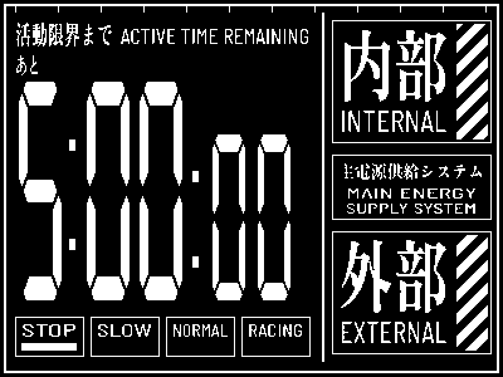
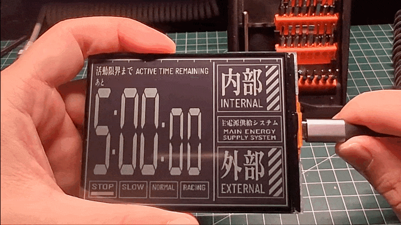

# EVA Countdown

A Neon Genesis Evangelion inspired, five-minute countdown specifically designed for the **Waveshare ESP32-S3-RLCD-4.2**. Built with OpenAI Codex.



See Video: https://www.youtube.com/shorts/I0qOmyr1DD8



## v0.1.0 — Prerelease notes

This is the first public prerelease: a small, working countdown to try on the **Waveshare ESP32-S3-RLCD-4.2**. Expect features to improve and change as the project develops.

Feedback and Bug reports are welcome. Include the firmware version, board model, and steps to reproduce the issue. See the [full release notes](docs/release-notes-v0.1.0.md) and [contribution guide](CONTRIBUTING.md).

## Follow the project

I share my builds and the things I learn along the way at [Kopigeek Builds](https://www.kopigeek.com).

## Support the project

If you enjoy EVA Countdown, sharing your build, reporting a bug, or giving the repository a star is a lovely way to support it. Thanks for trying it out! 

If you're planning to build one, you can support the project by purchasing the [Waveshare ESP32-S3-RLCD-4.2 through my affiliate link — placeholder](https://example.com/waveshare-affiliate). I may earn a commission if you purchase through the link.

Already have the hardware? You can also [buy me a coffee — placeholder](https://example.com/buy-me-a-coffee) to support future builds. No pressure—the project is free to use either way.

---

# Installation

## Hardware

| Item | Required |
| --- | --- |
| Board | Waveshare **ESP32-S3-RLCD-4.2**, ST7305 monochrome RLCD |
| Screen | 4.2-inch, 400 × 300 in landscape |
| Battery | Optional |

Note: Other displays and ESP32 boards have not been validated.

## Controls

| Action | Result |
| --- | --- |
| Short press/release **KEY** | Start or pause; resume a paused countdown |
| Hold **KEY** for 0.8 seconds | Reset to five minutes and pause |
| Press **BOOT** while the app runs | Reset to five minutes and pause |
| Press **KEY** after time expires | Start a fresh five-minute countdown |

## What it does
- Timer (5mins countdown) with start, pause, resume and reset.
- Uses the **True LCD NGE** digit font and **Zen Antique** Japanese lettering.
- Flashes the timer region during the final minute and stops at zero.
- Works offline: no Wi-Fi setup, account, SD card or runtime font loading.

## Agentic Build (OpenAI Codex)

Connect the Waveshare device with a USB data cable, open this project in Codex, and paste in the prompt:

```
Build this project for the Waveshare ESP32-S3-RLCD-4.2 using ESP-IDF. Identify the connected board and serial port, back up its existing firmware, then flash the countdown and check the startup log. Guide me through any setup needed.
```

Easy.

## Build and flash (Manual)

The tested toolchain is **ESP-IDF v5.4.2**, target `esp32s3`. Install and activate it using [Espressif's setup guide](https://docs.espressif.com/projects/esp-idf/en/v5.4.2/esp32s3/get-started/index.html). Run these commands in an ESP-IDF terminal:

```sh
git clone https://github.com/kopigeek-labs/eva-countdown.git
cd eva-countdown
idf.py set-target esp32s3
idf.py build
idf.py -p YOUR_SERIAL_PORT flash monitor
```

Replace `YOUR_SERIAL_PORT` with your board's port, such as `/dev/cu.usbmodem…` on macOS, `/dev/ttyACM0` on Linux, or `COM5` on Windows. Exit the monitor with **Ctrl+]**. Flashing replaces the installed application; preserve any firmware you need first.

The project uses only bundled ESP-IDF components and needs no external component downloads. Generated graphics are checked in, so Python graphics dependencies are **not needed to build or flash**. PSRAM is not required by this app. Waveshare recommends newer IDF versions for its full examples; only 5.4.2 has been validated for this reduced application.

## Development

Host checks require a C++17 compiler. Preview regeneration also requires Python 3.10+ and Pillow. The shell helpers support macOS/Linux; Windows users can use WSL for host development and an ESP-IDF terminal for firmware builds.

```sh
./tools/check.sh
python3 -m venv .venv
.venv/bin/pip install -r tools/requirements.txt
.venv/bin/python tools/generate_assets.py
PYTHON=.venv/bin/python ./tools/preview.sh
```

`CXX` overrides the host compiler. `PYTHON` overrides the preview export interpreter. The preview helper updates both the PBMs and README PNGs, including a [four-state contact sheet](preview/states.png).

| File | Purpose |
| --- | --- |
| `main/board.h` | Verified vendor pin assignments and display cadence |
| `main/main.cpp` | Input handling and app loop |
| `main/timer.h` | Monotonic countdown and button debounce |
| `main/render.h` | Shared firmware/host renderer and panel pixel packing |
| `main/display.cpp` | ST7305 initialization and synchronous SPI transport |
| `main/assets.h` | Generated monochrome bitmaps |
| `tools/generate_assets.py` | Offline generation from bundled font sources |

See [CONTRIBUTING.md](CONTRIBUTING.md) for the small-change workflow and [release preparation](docs/releasing.md) for packaging.


## Credits and licensing

Inspired by [Scotty Kwok's eva-timer](https://github.com/scottykwok/eva-timer) and the Evangelion timer design. Thanks to Waveshare for the display driver examples.

Original project code is **Apache-2.0**; fonts, reference artwork, and generated font-derived bitmaps retain their own terms. In particular, True LCD NGE digit adaptations retain **CC BY-SA 3.0**. See [LICENSE](LICENSE), [NOTICE](NOTICE), and [THIRD_PARTY.md](THIRD_PARTY.md) before redistributing assets.

This is an unofficial fan project, not affiliated with Evangelion rights holders.
