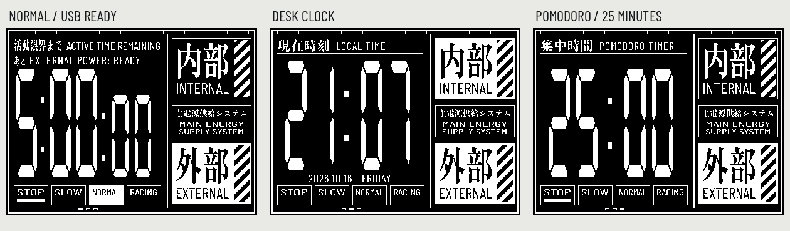

# EVA Countdown

An Evangelion-inspired desk companion for the **Waveshare ESP32-S3-RLCD-4.2**: countdown, offline clock and 25-minute Pomodoro. Built with OpenAI Codex.



See Video: https://www.youtube.com/shorts/I0qOmyr1DD8

## v0.2

New Features:

1. Evangelion Countdown: Normal countdown is five minutes; Racing is one minute.
2. Clock Mode (new) - tells the time and date, sits on your desk
3. Pomodoro (new) - 25mins Pomodoro timer mode

**Animation Improvements**: Via an awake computer USB connection, Countdown highlights External power. Disconnecting USB triggers the handover animation to "Internal" power and starts the timer when Countdown is selected.

Feedback and Bug reports are welcome.

## v0.1.0 — Prerelease notes

The original version: an evangelion inspired countdown timer to try on the **Waveshare ESP32-S3-RLCD-4.2**. Expect features to improve and change as the project develops.

## Follow the project

I share my builds and the things I learn along the way at [Kopigeek Builds](https://www.kopigeek.com). The code stays free and open source under Apache 2.0. Sharing your build or giving the repository a star helps too.

## Help fund the next weekend build

I'm a hobbyist, and this is something I work on during the weekends. If you enjoy EVA Countdown, **buy me a coffee or use my Waveshare affiliate link** to help me keep building and sharing.

Your support earns me a few more **wife approval points** for the next hardware purchase. ☕

**[Buy me a coffee — fuel the next build](https://buymeacoffee.com/kopigeek)** (Prefer Ko-fi? [You can support me there](https://ko-fi.com/L1C828Q8LH).)

**[Get the Waveshare board through my affiliate link](https://www.waveshare.com/esp32-s3-rlcd-4.2.htm?&aff_id=187720)**

**Affiliate disclosure:** I may earn a commission if you purchase through the Waveshare link.


---

# Installation

## Hardware

| Item | Required |
| --- | --- |
| Board | Waveshare **[ESP32-S3-RLCD-4.2](https://www.waveshare.com/esp32-s3-rlcd-4.2.htm?&aff_id=187720)** (affiliate link), ST7305 monochrome RLCD |
| Screen | 4.2-inch, 400 × 300 in landscape |
| Battery | Optional |

Note: Other displays and ESP32 boards have not been validated.

## Controls (v0.2)

| Action | Result |
| --- | --- |
| **BOOT** click | Countdown → Clock → Pomodoro |
| Hold **BOOT** for 0.8 s in Countdown | Switch Normal (5 min) / Racing (1 min); reset and pause |
| **KEY** click in Countdown / Pomodoro | Start, pause or resume; restart after expiry |
| Hold **KEY** for 0.8 s in Countdown / Pomodoro | Reset selected timer and pause |

Pomodoro keeps running when you change screens. Clock shows both power panels highlighted; they are decorative in that mode. The STOP / SLOW / NORMAL / RACING strip is retained as reference artwork in Clock and Pomodoro; those speed labels are not selectable there. Clock's KEY controls are unused. Mode and timer state reset when the device restarts.

## Set the clock

The offline clock uses the board's PCF85063 RTC. Set it to your computer's local time using a USB data cable:

```sh
python3 -m venv .venv
.venv/bin/pip install -r tools/requirements.txt
.venv/bin/python tools/set_clock.py --port YOUR_EVA_SERIAL_PORT
```

Close serial monitors first. The helper checks the firmware identity and verifies the RTC write. Use `--read` to read it without changing it. No Wi-Fi setup is needed.

## What it does

- Keeps the True LCD NGE digits and Zen Antique lettering, with distinct power highlights.
- Normal 5-minute and Racing 1-minute countdowns, with start/pause/resume/reset and final-ten-second warning flashes.
- Offline desk clock with date/day of the week and an honest unset-clock screen.
- 25-minute Pomodoro sessions with background countdown and completion notice.
- Runs offline without an account, SD card or runtime font loading.

## Agentic Build (OpenAI Codex)

Connect the Waveshare **[ESP32-S3-RLCD-4.2](https://www.waveshare.com/esp32-s3-rlcd-4.2.htm?&aff_id=187720)** device with a USB data cable, open this project in Codex, and paste in the prompt:

```
Build this project for the Waveshare ESP32-S3-RLCD-4.2 using ESP-IDF. Identify the connected board and serial port, verify an existing recovery backup or make one if needed, then flash EVA Countdown and check the startup log. Guide me through any setup needed.
```

## Build and flash (Manual)

The tested toolchain is **ESP-IDF v5.4.2**, target `esp32s3`. Install and activate it using [Espressif's setup guide](https://docs.espressif.com/projects/esp-idf/en/v5.4.2/esp32s3/get-started/index.html). Run these commands in an ESP-IDF terminal:

```sh
git clone https://github.com/kopigeek-labs/eva-countdown.git
cd eva-countdown
idf.py set-target esp32s3
idf.py build
idf.py -p YOUR_SERIAL_PORT flash monitor
```

Replace `YOUR_SERIAL_PORT` with your board's port, such as `/dev/cu.usbmodem…` on macOS, `/dev/ttyACM0` on Linux, or `COM5` on Windows. Exit the monitor with **Ctrl+]**. This flash command writes the bootloader, partition table and application; preserve any existing firmware and data you need first.

The project uses only bundled ESP-IDF components and needs no external component downloads. Generated graphics are checked in, so Python graphics dependencies are **not needed to build or flash**. PSRAM is not required by this app. Waveshare recommends newer IDF versions for its full examples; only 5.4.2 has been validated for this reduced application.

## Development

Host checks require a C++17 compiler. Preview regeneration also requires Python 3.10+ and Pillow. The shell helpers support macOS/Linux; Windows users can use WSL for host development and an ESP-IDF terminal for firmware builds.

```sh
./tools/check.sh
python3 -m venv .venv
.venv/bin/pip install -r tools/requirements.txt
.venv/bin/python tools/fetch_fonts.py
.venv/bin/python tools/generate_assets.py
.venv/bin/python tools/generate_ui.py
PYTHON=.venv/bin/python ./tools/preview.sh
```

`CXX` overrides the host compiler. `PYTHON` overrides the preview export interpreter. Font sources are downloaded and hash-checked only for graphics regeneration; building the firmware uses the checked-in graphics. The preview helper updates the three-mode image above using the actual C++ renderer.

| File | Purpose |
| --- | --- |
| `main/board.h` | Verified vendor pin assignments and display cadence |
| `main/main.cpp` | Input handling and app loop |
| `main/timer.h` / `main/app.h` | Monotonic timers, buttons, mode and power state |
| `main/rtc.cpp` / `main/clock_time.h` | RTC driver and validated USB time-setting protocol |
| `main/render.h` | Shared firmware/host renderer and panel pixel packing |
| `main/display.cpp` | ST7305 initialization and synchronous SPI transport |
| `main/assets.h` | Generated monochrome bitmaps |
| `tools/generate_assets.py` | Graphics generation from downloaded, verified font sources |

See [CONTRIBUTING.md](CONTRIBUTING.md) for the small-change workflow.


## Credits and licensing

Inspired by [Scotty Kwok's eva-timer](https://github.com/scottykwok/eva-timer) and the Evangelion timer design. Thanks to Waveshare for the display driver examples.

Original project code is **Apache-2.0**; fonts, reference artwork, and generated font-derived bitmaps retain their own terms. In particular, True LCD NGE digit adaptations retain **CC BY-SA 3.0**. See [LICENSE](LICENSE), [NOTICE](NOTICE), and [THIRD_PARTY.md](THIRD_PARTY.md) before redistributing assets.

This is an unofficial fan project, not affiliated with Evangelion rights holders.
